# Architecture

This document explains how the EDA agent works, layer by layer. It covers how the data is read,
how the statistics are computed, how the LLM agent makes decisions, and how each run is logged
and compared with the last one.

- [1. The big picture](#1-the-big-picture)
- [2. Design principle: the LLM decides, code computes](#2-design-principle-the-llm-decides-code-computes)
- [3. Layer 1: data loading (`data.py`)](#3-layer-1-data-loading-datapy)
- [4. Layer 2: profiling (`profiling.py`)](#4-layer-2-profiling-profilingpy)
- [5. Layer 3: charts (`plots.py`)](#5-layer-3-charts-plotspy)
- [6. Layer 4: tools (`tools.py`)](#6-layer-4-tools-toolspy)
- [7. Layer 5: the agent (`agent.py`)](#7-layer-5-the-agent-agentpy)
- [8. Layer 6: run logging and drift detection (`run_log.py`)](#8-layer-6-run-logging-and-drift-detection-run_logpy)
- [9. Layer 7: the report (`report.py`)](#9-layer-7-the-report-reportpy)
- [10. The two entry points (`cli.py`)](#10-the-two-entry-points-clipy)
- [11. Testing strategy](#11-testing-strategy)
- [12. Limitations and trade-offs](#12-limitations-and-trade-offs)

---

## 1. The big picture

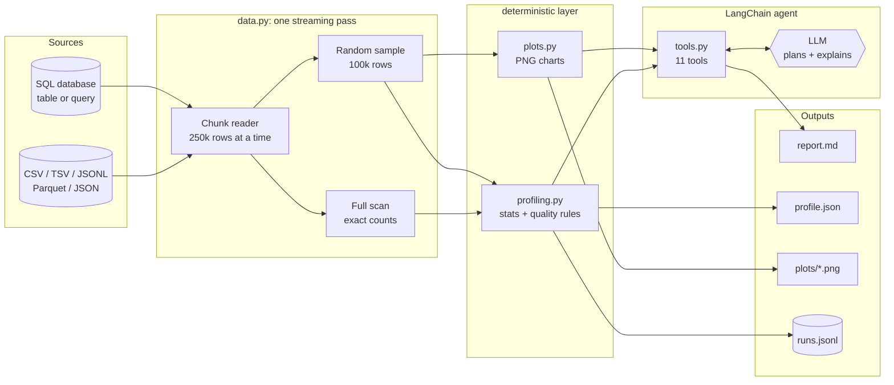

One run follows these steps:

1. **Load.** The file or database table is read once, in chunks. While reading, the loader keeps
   exact running totals (rows, nulls, min/max/mean, duplicate-row hashes) and a uniform random
   sample.
2. **Profile.** Pure functions turn the `Dataset` into JSON-serialisable dicts: schema, null
   audit, distributions, correlations, duplicates, and quality issues with a score.
3. **Analyse.** In `ask` mode, an LLM agent reads the question and calls tools that wrap the
   profiling functions. It reads the JSON each tool returns, decides what to look at next, and
   writes a summary. In `profile` mode there is no LLM; every profile is computed and written out.
4. **Log.** A snapshot of the run goes into `runs.jsonl`: whether the data was available, rows,
   schema, null rates, quality score, timings, and the tool calls the agent made. The snapshot is
   diffed against the previous run of the same dataset, and any problems are flagged.
5. **Report.** A Markdown report combines the tables, charts, run-over-run changes, and the
   agent's summary.

---

## 2. Design principle: the LLM decides, code computes

The most important design choice: **the LLM never calculates a number.**

| | LLM writes pandas code | This project: LLM calls fixed tools |
|---|---|---|
| Where numbers come from | model-generated code, different each run | the same tested functions every time |
| Made-up statistics | possible: the model can state a number it never computed | the system prompt requires every number to come from a tool result |
| Safety | executes arbitrary generated code | no code execution; tools take typed arguments |
| Reproducibility | low | the same data always gives the same profile |
| Cost / tokens | large dataframes printed into context | compact JSON, capped at 6,000 characters per call |

The LLM handles the parts that need judgement: which columns look odd, which relationship is
worth a scatter plot, which quality problem matters most, and how to explain all of that in
plain English. The code handles the parts that need to be correct.

This split also makes `profile` mode possible: the same functions run with no LLM and no API key.

---

## 3. Layer 1: data loading (`data.py`)

### The problem

A 10 GB CSV doesn't fit comfortably in memory, but some EDA questions need every row. "How
many nulls are in `region`?" has an exact answer, and a sample can't give it. Other questions,
like "what is the shape of the distribution?" or "how correlated are these columns?", are
answered just as well by a large random sample.

### The solution: one pass, two outputs

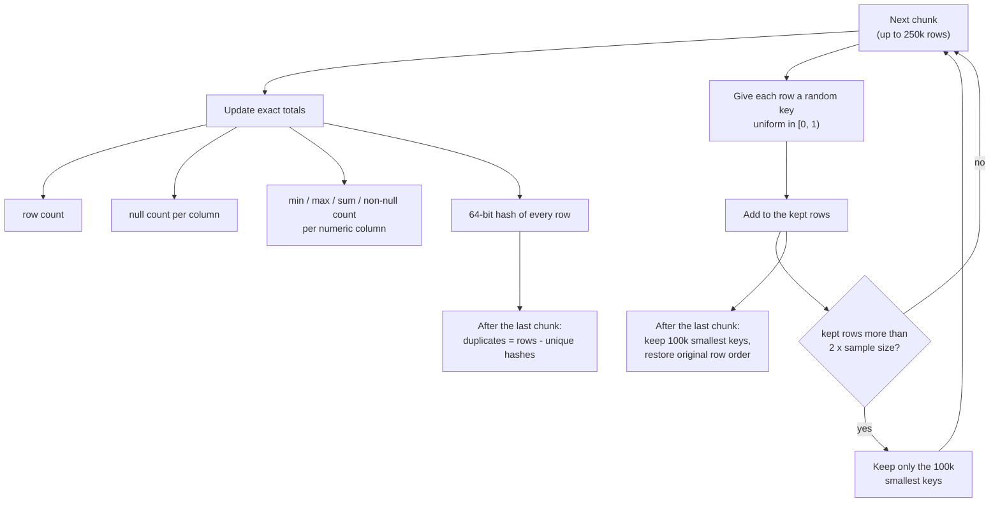

**Exact statistics (`FullScan`).** Each chunk adds to running totals. The mean is exact because
it is computed as Σx / n across all chunks, not from the sample.

**Duplicate rows.** Duplicates are the one statistic a sample gets badly wrong: two copies of a
row both land in a 20% sample only about 4% of the time. So every row is hashed with
`pandas.util.hash_pandas_object` (8 bytes per row) and duplicates are counted as
`total rows - unique hashes`. On the sample dataset, the sample-based estimate was 0.04% and the
exact count is 0.2%. The exact count is the one the tool reports.

**Uniform sampling without knowing the size in advance.** Rows arrive in a stream and the total
isn't known until the end. Each row gets an independent random key, and the loader keeps the
rows with the smallest keys. Every row has the same chance of having one of the 100k smallest
keys, so the result is a uniform random sample of the whole file (a variant of reservoir
sampling). To keep memory bounded, the kept rows are trimmed back to the 100k smallest keys
whenever they grow past 200k. Peak memory is about 2 x sample size + 1 chunk, whatever the
file size.

The original row position is stored next to the key, so the final sample is put back in file
order (useful for time-ordered data).

### Sources

All sources produce the same thing, an iterator of DataFrame chunks, so the scanning logic
(`_scan`) is shared:

| Source | Reader |
|---|---|
| CSV / TSV | `pd.read_csv(chunksize=...)` |
| JSONL | `pd.read_json(lines=True, chunksize=...)` |
| Parquet | `pyarrow.ParquetFile.iter_batches()` |
| JSON | read whole (JSON arrays can't be streamed) |
| SQL table / query | SQLAlchemy engine + `pd.read_sql(chunksize=...)` with `stream_results=True` |

### A real bug this layer prevents

By default pandas treats the string `"NA"` as missing. In the sample orders data, `NA` is the
North America region code, so a default `read_csv` makes 45% of `region` look null. That
false finding would then appear in the report. The loader turns off the default markers and
only treats explicit ones (`""`, `null`, `NaN`, `None`, `N/A`, ...) as missing. A regression
test (`test_na_string_is_not_treated_as_null`) covers it.

### Database safety

- The URL comes from an environment variable (`EDA_DB_URL`), never from code.
- `redact_url()` replaces the password with `***` before the URL reaches a log, the run log, or a
  report.
- `--table` names are checked against the database's actual table list, and the statement is
  built with SQLAlchemy constructs rather than string formatting, so a name like
  `events; DROP TABLE events` is rejected.
- The agent has no tool that runs SQL. Only the table or query a human passes on the command
  line is ever run.

---

## 4. Layer 2: profiling (`profiling.py`)

Each function takes a `Dataset` and returns a plain dict. Exact values come from the full scan
and shape values come from the sample:

| Function | Output | Data used |
|---|---|---|
| `schema` | column, dtype, numeric/categorical, example value, schema hash | sample (dtypes) + scan (rows) |
| `null_audit` | nulls and % per column, high-null and fully-null columns | **scan (exact)** |
| `numeric_distribution` | mean, std, min, p1/p25/median/p75/p99, max, skew, shape label, zero %, negative %, IQR outliers | mean/min/max from **scan**; the rest from sample |
| `categorical_summary` | distinct count, cardinality ratio, top values, likely-ID flag | sample |
| `correlations` | Pearson or Spearman matrix, strongest pairs, pairs with \|r\| ≥ 0.8 | sample |
| `duplicates` | exact duplicate rows and % | **scan (exact)** |
| `group_aggregate` | mean/median/sum/count/min/max/std/nunique by group | sample |
| `quality_issues` | list of issues with severities, and a 0–100 score | both |

### Quality rules

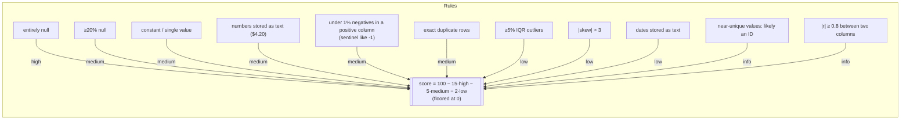

Some of the rules need explaining:

- **Sentinel detection.** A column that is almost all positive but has a small share (under 1%)
  of negatives usually means someone used `-1` or `-999` for "unknown". These values distort
  the mean and the correlations, so they get flagged.
- **Numbers stored as text.** Up to 500 non-null values are checked. After stripping `$`, `,`,
  and `%`, if more than 95% parse as numbers, the column is flagged.
- **Dates stored as text.** Values must match a date-like pattern *and* more than 95% must parse
  with `pd.to_datetime`. The pattern check comes first, so plain numbers aren't mistaken for
  dates.
- **Likely an ID.** Distinct values ≥ 90% of non-null values (with more than 50 rows). This is
  only `info` severity: IDs aren't a problem, but they shouldn't be grouped by or correlated.

The score is a simple weighted count, meant for **comparing runs of the same dataset over time**
rather than comparing different datasets.

---

## 5. Layer 3: charts (`plots.py`)

Matplotlib runs headless (the `Agg` backend) and saves PNGs. All charts use the sample, except
the null chart, which uses the exact scan.

| Chart | When |
|---|---|
| Null rate by column | always; columns ≥20% null are drawn in red |
| Correlation heatmap | if there are 2 or more varying numeric columns; values printed when ≤15 columns |
| Histogram | numeric columns (with a median line), or a bar chart of the top 15 values for categorical columns |
| Scatter + linear fit | on request from the agent, capped at 5,000 points |

<p>
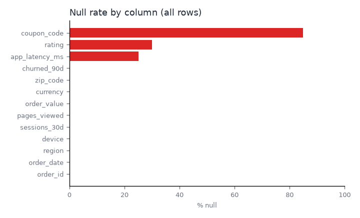
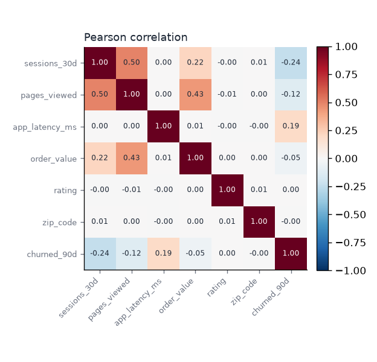
</p>
<p>
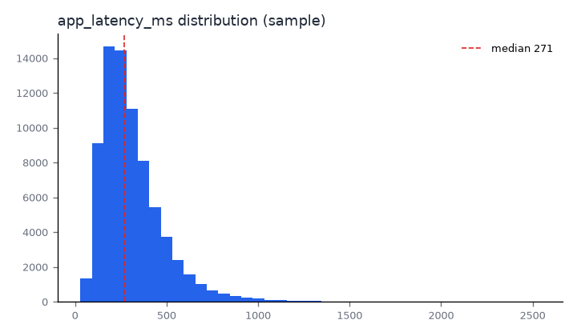
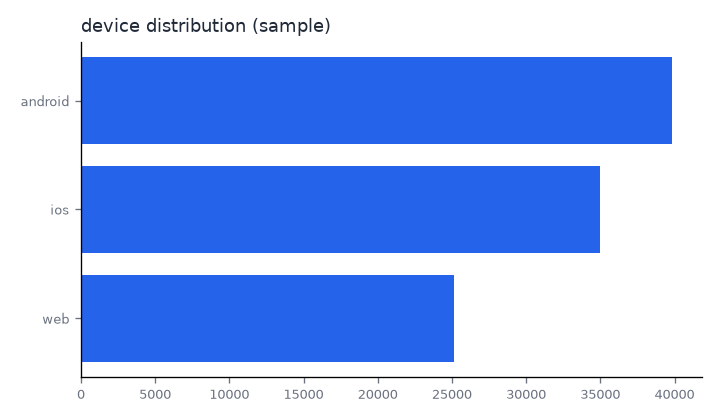
</p>

---

## 6. Layer 4: tools (`tools.py`)

The tools are what the LLM can do. Each one is a LangChain `@tool`. The model sees its name,
docstring, and typed arguments as a JSON schema.

| Tool | What it does |
|---|---|
| `list_datasets` | names, rows, columns, whether sampled |
| `describe_schema` | column types and examples |
| `null_audit` | exact null counts |
| `distribution_overview` | short stats for every column |
| `profile_column` | deep dive on one column |
| `correlation_analysis` | strongest pairs (Pearson / Spearman) |
| `data_quality_check` | issues + score |
| `group_aggregate` | aggregate one column by another |
| `plot` | histogram / scatter / correlation / nulls PNG |
| `run_history` | earlier runs of this dataset and their flagged changes |
| `write_report` | writes the Markdown report with the agent's summary |

### The `logged` wrapper

Every tool goes through the same wrapper:

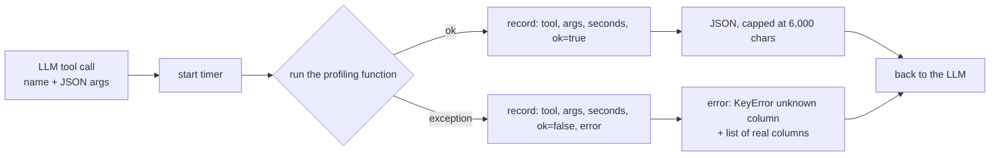

Two details matter here:

1. **Errors become messages, not crashes.** If the model asks for a column that doesn't exist,
   the error lists the real columns. The model reads it and tries again, and the run continues.
2. **Every call is recorded.** The list of tool calls, with timing and success, is saved in the
   run log. So you can audit what the agent actually looked at before writing its conclusions.

The `Workspace` object holds the loaded datasets, the output directory, the run logger, and the
artifacts produced so far. The tools are closures over it, so the LLM only ever passes small
values such as dataset names, column names, and options. It never passes data.

---

## 7. Layer 5: the agent (`agent.py`)

The agent is built with LangChain 1.x `create_agent`, which compiles a LangGraph state machine.
At each step the model either requests tool calls or returns a final answer.

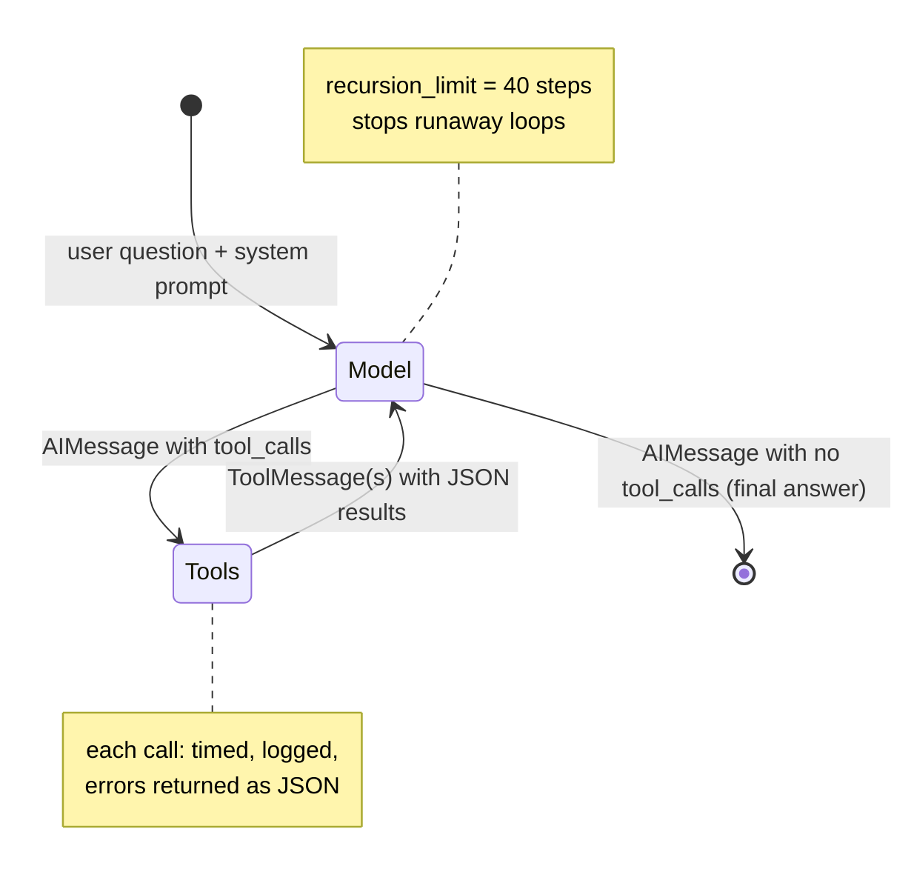

### What a full-EDA session looks like

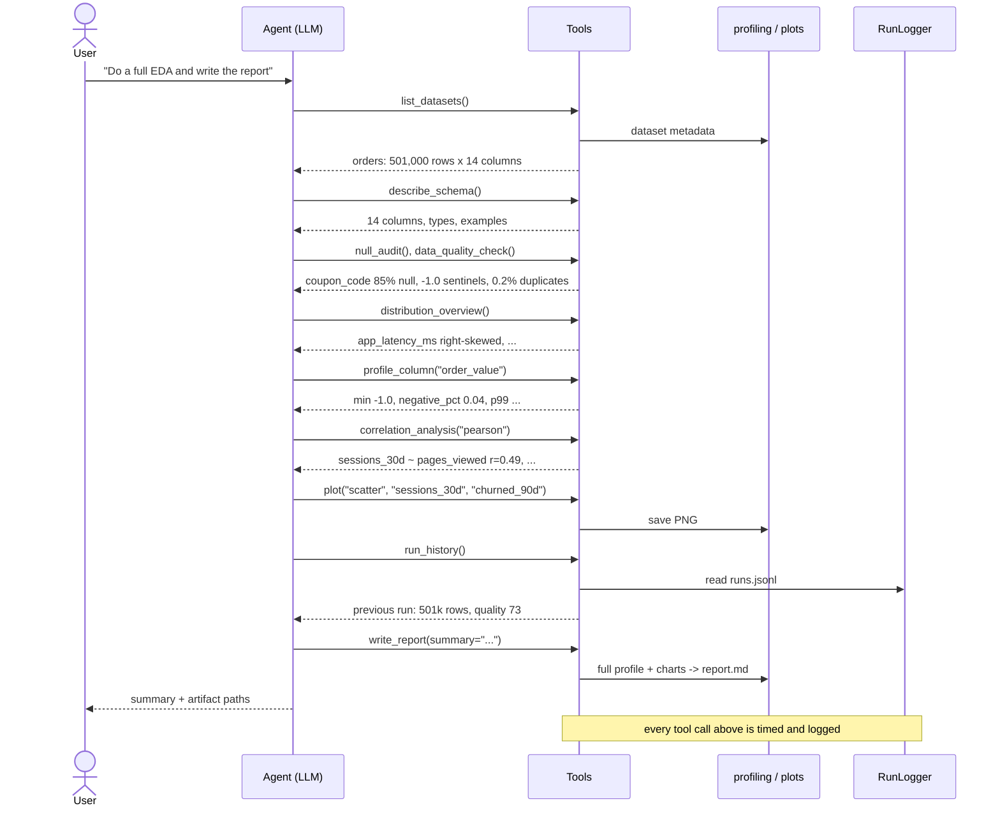

### The system prompt

The prompt in `agent.py` does three things:

1. **Sets a hard rule:** every number must come from a tool result in the conversation, never
   estimated.
2. **Gives a default plan** for an open-ended EDA: schema, then quality, then distributions,
   then deep dives on anything unusual, then correlations, then history, then the report. Trust
   comes first: you check whether the data is reliable before interpreting it.
3. **Sets reporting norms:** say when a number comes from the sample, and don't present
   correlation as causation.

For a specific question ("which device has the worst latency?") the prompt tells the agent to
use the fewest tools needed. That is usually one `group_aggregate` call instead of the whole
plan.

### Model choice

`create_agent` accepts any LangChain `provider:model` string. The default is
`anthropic:claude-sonnet-5-5`. Override it with `--model` or the `EDA_AGENT_MODEL` environment
variable, e.g. `openai:gpt-5` after `pip install ".[openai]"`. Nothing else in the code depends
on the provider.

---

## 8. Layer 6: run logging and drift detection (`run_log.py`)

EDA usually happens once. But pipelines run every day, and the most useful question is often
"*what changed since yesterday?*" Every run appends one JSON line to `runs.jsonl`. This is the real entry from the degraded "day 2" sample run (pretty-printed, column list shortened):

```json
{
  "run_id": "cf951d235b",
  "timestamp": "2026-11-11T18:32:38+0000",
  "dataset": "orders",
  "path": "day2/orders.csv",
  "available": true,
  "file_bytes": 18921944,
  "rows": 300600,
  "columns": [
    "order_id",
    "order_date",
    "region",
    "... 13 columns"
  ],
  "schema_hash": "7efd5b536d73",
  "overall_null_pct": 10.77,
  "null_pct_by_column": {
    "coupon_code": 84.9,
    "rating": 29.97,
    "app_latency_ms": 25.1
  },
  "quality_score": 68,
  "issue_count": 8,
  "changes": [
    {
      "kind": "row_drop",
      "severity": "high",
      "message": "row count fell 40.0% (501,000 -> 300,600)"
    },
    {
      "kind": "columns_removed",
      "severity": "high",
      "message": "missing columns: ['discount_rate']"
    },
    {
      "kind": "null_jump",
      "severity": "medium",
      "message": "app_latency_ms: null rate 0.0% -> 25.1%"
    },
    {
      "kind": "quality_drop",
      "severity": "low",
      "message": "quality score 73 -> 68"
    }
  ],
  "tool_calls": [
    "... in ask mode: one entry per tool call, e.g. {\"tool\": \"null_audit\", \"args\": {}, \"seconds\": 0.004, \"ok\": true}"
  ],
  "load_seconds": 0.495,
  "run_seconds": 0.787
}
```

### How the diff works

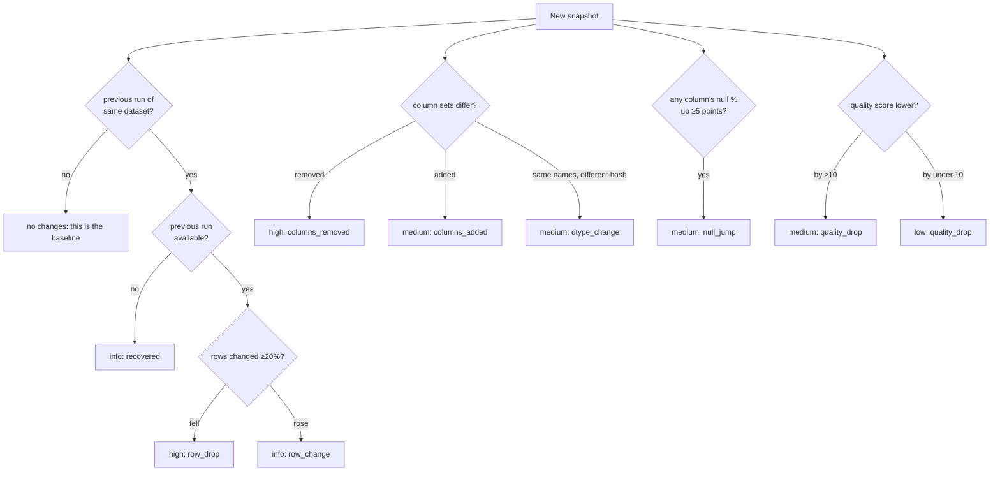

If the source can't be read at all (missing file, unknown table, database error), the loader
doesn't crash the batch. It writes an `available: false` entry with a high-severity
`unavailable` change and carries on with the other datasets. The next successful run is
flagged as `recovered`.

The **schema hash** is the first 12 hex characters of a SHA-256 over `column:dtype` pairs. Same
column names with a different hash means a type changed, e.g. a numeric column that is now
being read as text because bad values arrived.

### Application logging

Separately from `runs.jsonl`, standard Python `logging` writes to the console and to
`eda_output/eda_agent.log`: rows loaded per chunk, each tool call with timing, and run-over-run
problems as `WARNING`s. Noisy HTTP-library loggers are turned down to `WARNING`.

---

## 9. Layer 7: the report (`report.py`)

The report is plain Markdown, so it renders on GitHub, in VS Code, or in any docs tool. Sections:

1. Header: rows x columns, size or source, quality score, schema hash, and a note on sampling
2. Agent summary (`ask` mode only)
3. Changes since last run
4. Data quality issues
5. Schema
6. Null audit
7. Numeric distributions
8. Categorical columns
9. Strongest correlations, duplicate rate
10. Charts (relative image links)

See [`example/orders_report.md`](example/orders_report.md) for a real one.

---

## 10. The two entry points (`cli.py`)

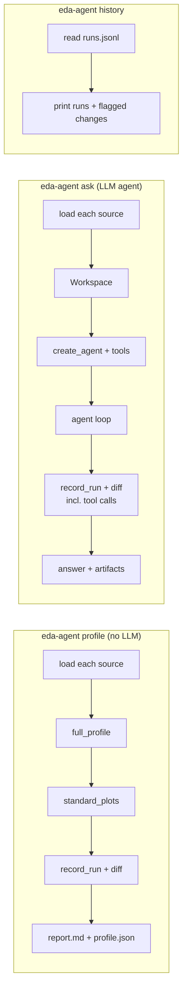

- **`profile`** is deterministic and free. Use it in scheduled jobs or CI to monitor a dataset
  every day.
- **`ask`** is for exploration: open-ended EDA or specific questions.
- **`history`** shows the run log.

The LLM import is lazy, so `profile` and `history` work without LangChain provider packages or
API keys.

---

## 11. Testing strategy

| Test file | What it checks |
|---|---|
| `test_profiling.py` | an exact scan with a tiny sample and tiny chunks gives the **same** null and duplicate counts as a full load; the `"NA"` regression; each quality rule fires on a fixture with planted problems; correlations find the planted linear pair |
| `test_run_log.py` | shrinking the file, dropping a column, and nulling values triggers `row_drop`, `columns_removed`, `null_jump`; unavailable sources are logged |
| `test_sql.py` | a SQLite table gives exactly the same scan as the CSV; queries work; injection-style table names are rejected; passwords are redacted; the CLI end to end with timing |
| `test_agent.py` | runs the **real** `create_agent` loop with a scripted chat model that issues a fixed sequence of tool calls. It checks that the tools ran in order, all succeeded, were logged, and that the report contains the summary and the requested chart. A tool error is returned as JSON instead of raising |

The scripted model means the agent's wiring (tool schemas, the message loop, logging, report
writing) is tested in CI with no API key and no flaky network calls. What it does *not* test is
the quality of a real model's reasoning. That needs a live run.

CI (GitHub Actions) runs the tests on Python 3.10 and 3.12, then generates a 50k-row dataset and
runs `eda-agent profile` on it as a smoke test.

---

## 12. Limitations and trade-offs

- **Shape statistics are sample-based.** Quantiles, std, skew, correlations, and group
  aggregates use the 100k-row sample (configurable with `--sample-rows`). Rare categories or
  extreme tails can be missed. The report always says when a sample was used.
- **Duplicate hashing memory** is 8 bytes per row: about 800 MB for 100M rows. For far larger
  tables, profile a query that samples or partitions the data on the database side.
- **The quality score is a heuristic.** It is useful for tracking one dataset over time, not for
  ranking unrelated datasets.
- **JSON arrays aren't streamed.** Use JSONL or Parquet for big files.
- **Agent output quality depends on the model.** The tools make the numbers reliable, but which
  questions get asked, and how the findings are explained, is up to the LLM.
