# EDA report: orders

**300,600 rows x 13 columns** · 18.92 MB · quality score **68/100** · schema `7efd5b536d73`

Exact counts use all rows; shape statistics use a uniform sample of 100,000 rows.

## Changes since last run

- **high** row count fell 40.0% (501,000 -> 300,600)
- **high** missing columns: ['discount_rate']
- **medium** app_latency_ms: null rate 0.0% -> 25.1%
- **low** quality score 73 -> 68

## Data quality issues

| severity | column | issue |
|---|---|---|
| medium | coupon_code | 84.9% null |
| medium | rating | 29.97% null |
| medium | app_latency_ms | 25.1% null |
| medium | order_value | 0.06% negative values in a mostly positive column (min=-1.0); possible sentinel or bad rows |
| info | order_id | near-unique values (likely an ID) |
| low | order_date | dates stored as text; parse before time-based analysis |
| medium | currency | single distinct value |
| medium |  | 0.13% duplicate rows |

## Schema

| column | dtype | kind | example |
|---|---|---|---|
| order_id | str | categorical | o00000001 |
| order_date | str | categorical | 2026-01-13 |
| region | str | categorical | LATAM |
| device | str | categorical | ios |
| sessions_30d | int64 | numeric | 5 |
| pages_viewed | int64 | numeric | 38 |
| app_latency_ms | float64 | numeric | 213.2 |
| order_value | float64 | numeric | 42.75 |
| coupon_code | str | categorical | SAVE10 |
| rating | float64 | numeric | 5.0 |
| currency | str | categorical | USD |
| zip_code | int64 | numeric | 98405 |
| churned_90d | int64 | numeric | 1 |

## Null audit

Overall null rate 10.77%; 3 columns have nulls.

| column | nulls | null_pct |
|---|---|---|
| coupon_code | 255221 | 84.9 |
| rating | 90097 | 29.97 |
| app_latency_ms | 75444 | 25.1 |

## Numeric distributions

| column | mean | std | min | p25 | median | p75 | max | skew | iqr_outlier_pct |
|---|---|---|---|---|---|---|---|---|---|
| sessions_30d | 7.0049 | 2.4521 | 1.0 | 5.0 | 7.0 | 9.0 | 23.0 | 0.411 | 0.14 |
| pages_viewed | 31.5111 | 22.3736 | 0.0 | 16.0 | 26.0 | 42.0 | 319.0 | 1.739 | 3.56 |
| app_latency_ms | 310.2115 | 171.2229 | 28.2 | 191.3 | 270.9 | 384.0 | 2979.5 | 1.83 | 3.87 |
| order_value | 71.8632 | 41.4292 | -1.0 | 44.24 | 62.63 | 88.59 | 858.02 | 2.28 | 4.2 |
| rating | 3.0084 | 1.416 | 1.0 | 2.0 | 3.0 | 4.0 | 5.0 | 0.007 | 0.0 |
| zip_code | 55040.3505 | 25987.6027 | 10000.0 | 32664.0 | 55130.0 | 77573.25 | 99998.0 | -0.001 | 0.0 |
| churned_90d | 0.2944 | 0.4553 | 0.0 | 0.0 | 0.0 | 1.0 | 1.0 | 0.908 | 0.0 |

## Categorical columns

| column | distinct | top |
|---|---|---|
| order_id | 99932 | o00004195 (0.0%), o00004673 (0.0%), o00011528 (0.0%) |
| order_date | 300 | 2026-01-28 (0.39%), 2026-01-07 (0.38%), 2026-07-04 (0.38%) |
| region | 4 | NA (45.05%), EU (30.08%), APAC (17.9%) |
| device | 3 | android (39.86%), ios (34.99%), web (25.15%) |
| coupon_code | 3 | VIP (33.79%), SAVE10 (33.32%), WELCOME (32.9%) |
| currency | 1 | USD (100.0%) |

## Strongest correlations

| a | b | r |
|---|---|---|
| sessions_30d | pages_viewed | 0.497 |
| pages_viewed | order_value | 0.43 |
| sessions_30d | churned_90d | -0.238 |
| sessions_30d | order_value | 0.217 |
| app_latency_ms | churned_90d | 0.188 |
| pages_viewed | churned_90d | -0.121 |
| order_value | churned_90d | -0.049 |
| sessions_30d | zip_code | 0.006 |
| pages_viewed | rating | -0.005 |
| app_latency_ms | order_value | 0.005 |

Duplicate rows: 0.13% (exact, across all rows).

## Charts

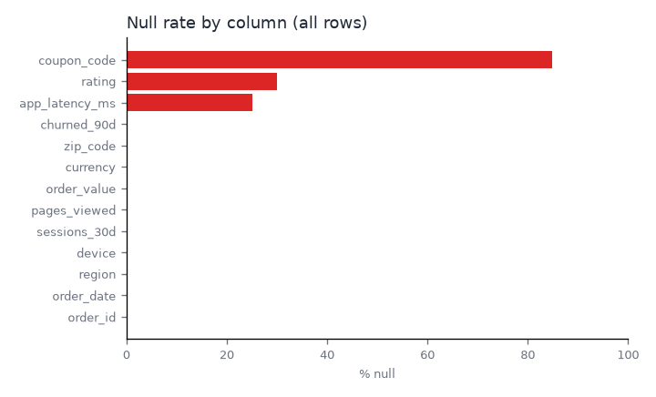
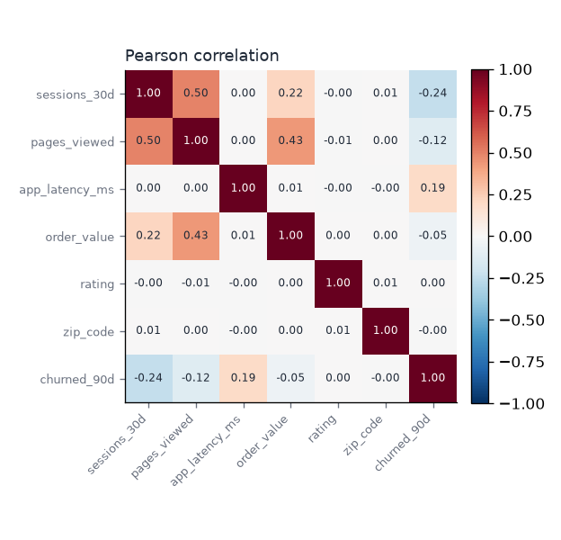
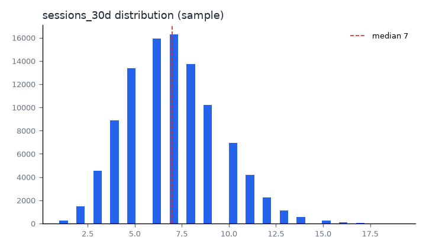
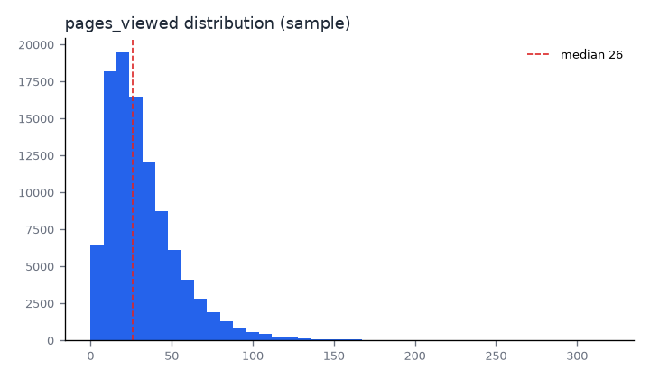
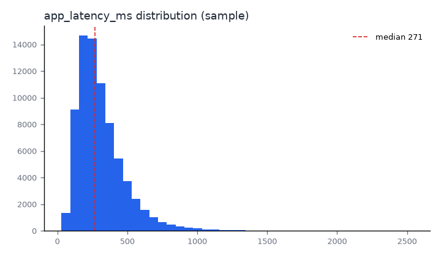
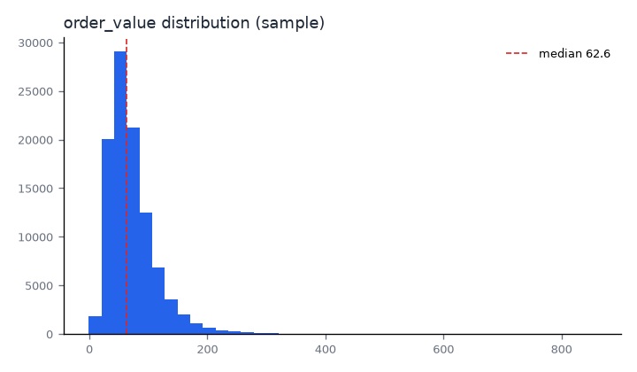
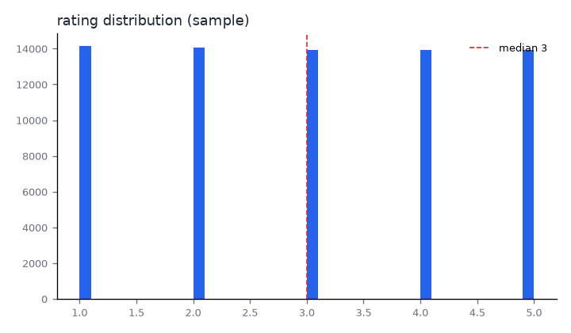
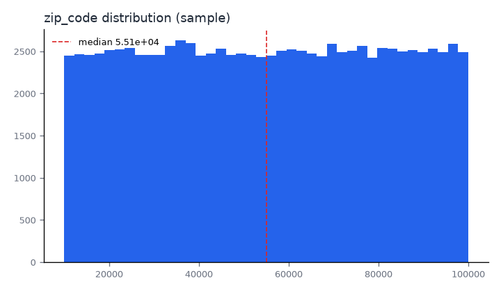
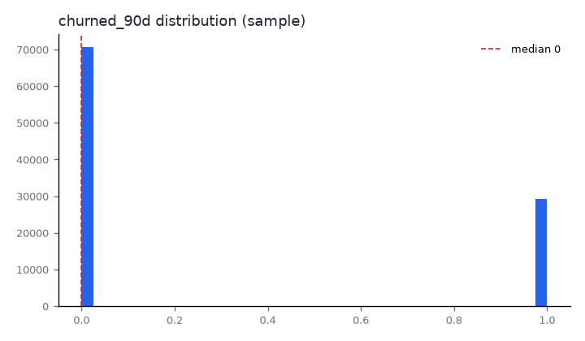
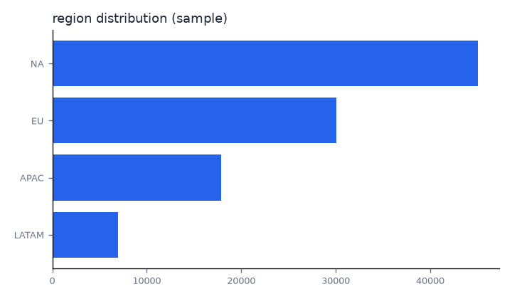
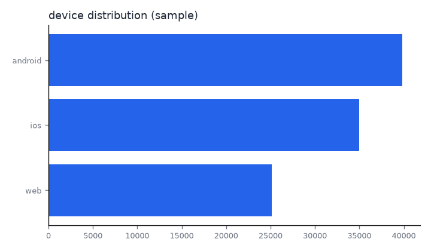
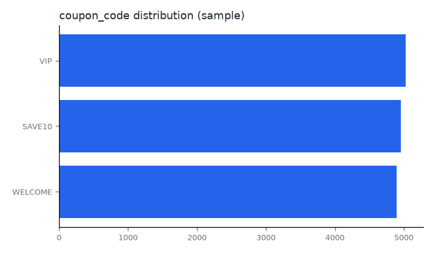
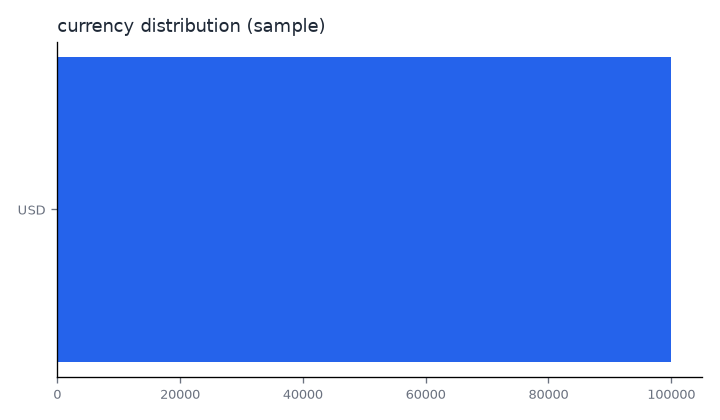
